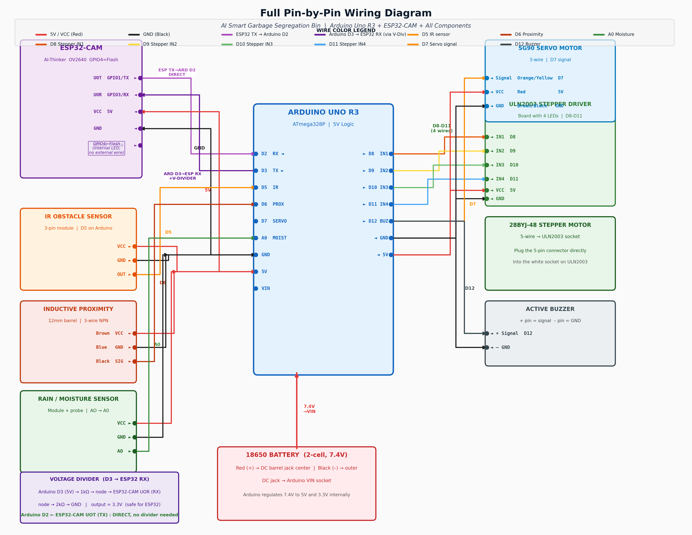

# AI-Based Smart Garbage Segregation Bin

An IEEE capstone project that automatically sorts waste into five
categories — **wet, dry, plastic, biomedical, recyclable** — combining a
camera-based AI classifier, an inductive proximity sensor for instant metal
detection, and a moisture-sensor fallback for when the AI pipeline is
unavailable.



---

## Table of contents

- [Problem statement](#problem-statement)
- [System overview](#system-overview)
- [Hardware](#hardware)
- [Software stack](#software-stack)
- [How it works — full workflow](#how-it-works--full-workflow)
- [Power architecture](#power-architecture)
- [Repository structure](#repository-structure)
- [Setup guide](#setup-guide)
- [Design decisions and lessons learned](#design-decisions-and-lessons-learned)
- [Known limitations](#known-limitations)
- [Future improvements](#future-improvements)
- [License](#license)

---

## Problem statement

Manual waste segregation at the point of disposal is inconsistent — people
often drop items into the wrong bin, mixing recyclables, biomedical waste,
and organics together. This makes downstream sorting (at municipal
facilities) slower, dirtier, and more expensive, and increases contamination
of otherwise-recyclable material.

This project automates that first sorting step: a single smart bin that
identifies what's being thrown away and routes it to the correct
compartment automatically, using a mix of cheap, reliable sensors for the
"easy" cases (metal, wet/dry) and a trained image classifier for everything
else.

## System overview

The bin has two "brains" working together:

- **Arduino Uno R3** — real-time controller. Reads sensors, drives the
  stepper motor and servo, and makes the final sorting decision.
- **ESP32-CAM + laptop server** — the "AI brain." Captures a photo of the
  item and asks a TensorFlow model (running in Flask on a laptop) what
  it is.

These talk to each other over a simple serial (UART) link: Arduino sends a
`CAPTURE` command, the ESP32-CAM does the photo + classification round trip
over WiFi, and sends back a single category digit.

## Hardware

| Component | Role |
|---|---|
| Arduino Uno R3 | Main controller — sensors, motors, decision logic |
| ESP32-CAM (AI-Thinker) + OV2640 | Captures images, talks to the inference server over WiFi |
| SG90 servo | Opens/closes the drop gate |
| 28BYJ-48 stepper + ULN2003 driver | Rotates the sorting mechanism between bins |
| IR sensor | Detects an object dropped into the chute |
| Inductive proximity sensor (12mm barrel) | Detects metal → instant recyclable routing, no camera needed |
| Moisture/rain sensor | Wet/dry fallback when the AI pipeline is unavailable |
| Active buzzer | Audio feedback at each stage |
| Laptop (Flask + TensorFlow) | Runs the trained classifier, serves the `/classify` endpoint |
| 18650 Li-ion battery pack(s), 7.4V | Main power source |
| Buck converter (LM2596S) or 7805 + heatsink | Dedicated, isolated 5V supply for the ESP32-CAM |
| 1kΩ + 2kΩ resistors | Voltage divider protecting ESP32's 3.3V-only RX pin from Arduino's 5V logic |

## Software stack

- **Arduino sketch (C++)** — sensor reads, stepper/servo control, UART
  protocol with the ESP32-CAM, moisture fallback logic.
- **ESP32-CAM sketch (C++, Arduino core)** — WiFi connection, camera
  capture, HTTP POST of the JPEG to the Flask server, relays the result
  back to Arduino over UART.
- **Flask server (Python)** — loads the trained `.h5` model, receives
  images over HTTP, runs inference, applies a confidence threshold, returns
  a single-character category code.
- **Model training (Google Colab / TensorFlow)** — image classification
  model trained on labelled waste photos across the five categories. See
  [`model/README.md`](model/README.md) for the notebook link and details.

## How it works — full workflow

1. Waste is dropped into the chute.
2. The **inductive proximity sensor** checks for metal first. If detected,
   the item is routed straight to **recyclable**, skipping the camera
   entirely — this keeps obviously-metal items fast and off the AI
   pipeline's load.
3. Otherwise, the **IR sensor** detects the object and Arduino sends a
   `CAPTURE` command to the ESP32-CAM over UART.
4. The **ESP32-CAM** takes a photo and POSTs the raw JPEG bytes to
   `http://<laptop-ip>:5000/classify`.
5. The **Flask server** runs the image through the TensorFlow model.
   - If the top prediction's confidence is ≥60%, it returns that category
     (`0`–`4`).
   - If confidence is below 60%, it returns `9` (low-confidence flag)
     rather than risk a wrong bin.
6. The ESP32-CAM relays this single character back to Arduino over UART.
7. Arduino waits up to 10 seconds for a response.
   - If it times out, or receives `9`, it falls back to the **moisture
     sensor** and decides wet vs. dry on its own.
8. The **stepper motor** rotates the sorting mechanism to the correct bin
   angle, the **servo** opens the gate to drop the item, then everything
   resets to the home position for the next item.

## Power architecture

This was the hardest part of the build, so it's documented in detail here
rather than buried in code comments.

**Problem:** the ESP32-CAM draws sharp current spikes (up to ~800 mA)
during WiFi transmission and image capture. Early versions of this project
powered ESP32-CAM from the same rail as the Arduino, servo, and stepper
motor. Under real operating conditions, this caused brownouts — the
ESP32-CAM would silently reset mid-capture, which looked from the outside
like a communication timeout (`[WARN] ESP32 timeout`), even though the
UART wiring and firmware logic were both correct. This was confirmed by
testing the exact same code on stable USB power (worked perfectly every
time) versus the shared battery rail (failed almost every time).

**Fix:** ESP32-CAM gets its own dedicated 5V supply, completely isolated
from the Arduino/sensor/motor power path:

```
Battery 7.4V ──┬──► Arduino VIN (existing path — Arduino + sensors + servo + stepper)
               │
               └──► Buck converter (LM2596S, set to 5V) ──► ESP32-CAM 5V only
                     [+ 470–1000µF capacitor at ESP32-CAM's 5V/GND pins]
```

Both paths share a **single common ground** — this is required for the
UART link between Arduino and ESP32-CAM to work at all, since digital
signals are only meaningful relative to a shared 0V reference. Only the
positive rails are isolated from each other.

A 7805 linear regulator (with heatsink + input/output capacitors) works as
an alternative to the buck converter, at the cost of running warmer and
having less voltage headroom margin as the battery discharges.

**Second issue found during testing:** ESP32's UART0 (`Serial`) is the
same physical wire used both for the `CAPTURE`/result-byte protocol *and*
for any debug `Serial.print()` calls in the ESP32 sketch. Early versions
printed things like `"Image size: 3640 bytes"` for debugging — and
Arduino's parser, which just grabs the first digit `0`–`4` it sees on the
wire, would occasionally latch onto a stray digit from that debug text
(e.g. the `3` in `3640`) instead of the real result byte, causing
intermittent wrong-bin selections that looked like AI misclassification
but were actually a protocol bug. The fix: the ESP32 sketch in this repo
sends **only** the single result byte over `Serial`, with no debug text at
all — status during development is shown via flash-LED blink codes
instead.

See `docs/wiring_diagram.png` for full pin-by-pin wiring, including the
resistor divider on the Arduino→ESP32 RX line (ESP32's UART pins are not
5V tolerant, and Arduino is a 5V-logic board).

## Repository structure

```
arduino/arduino_final_v2/     Arduino Uno sketch — sensors, motors, fallback logic
esp32cam/esp32cam_clean/      ESP32-CAM sketch — capture + HTTP POST, clean UART0
server/                       Flask inference server + trained model + its own README
model/                        Model training notes + Colab notebook link
docs/                         Wiring diagram and reference images
```

## Setup guide

### 1. Train or obtain the model
See [`model/README.md`](model/README.md) — training happens in Google
Colab. Export `waste_classifier.h5` and `class_names.json` into `server/`.

### 2. Run the inference server
See [`server/README.md`](server/README.md) for setup and the API spec.

```bash
cd server
pip install -r requirements.txt
python laptop_server_final.py
```

### 3. Flash the ESP32-CAM
Open `esp32cam/esp32cam_clean/esp32cam_clean.ino` in Arduino IDE. Update
`WIFI_SSID`, `WIFI_PASSWORD`, and `SERVER_URL` (use your laptop's LAN IP
from `ipconfig`/`ifconfig`) to match your network. Select board
**AI Thinker ESP32-CAM** and upload.

### 4. Flash the Arduino
Open `arduino/arduino_final_v2/arduino_final_v2.ino`, select **Arduino
Uno**, and upload. Requires the `CheapStepper` and `Servo` libraries
(install via Library Manager if missing).

### 5. Wire it up
Follow `docs/wiring_diagram.png`, paying close attention to the
[power architecture](#power-architecture) section above — this is the part
most likely to cause silent failures if skipped.

### 6. Run it
1. Start the Flask server on your laptop.
2. Power on the bin.
3. Drop waste into the chute and watch the Arduino serial monitor
   (9600 baud) for the full decision trail — object detection, capture
   command, AI result or fallback, motor movement.

## Design decisions and lessons learned

- **Two-brain split (Arduino + ESP32-CAM)** rather than doing everything on
  one board: Arduino handles real-time, safety-critical motor control
  reliably, while the ESP32-CAM/WiFi/HTTP stack — which is comparatively
  slow and occasionally flaky — is isolated behind a timeout and fallback
  path, so a network hiccup never leaves the bin stuck.
- **Confidence threshold + fallback, not just top-1 classification**: a
  wrong bin is worse than a slightly-slower correct one, so anything under
  60% confidence defers to the moisture sensor rather than guessing.
- **Metal bypass via proximity sensor**: metal objects are unambiguous and
  don't need a full camera round-trip, so they're handled instantly and
  deterministically.
- **Power isolation was the single biggest reliability issue** in this
  build, and is documented in detail above because it's easy to miss —
  the symptoms (UART timeouts) look like a wiring or firmware bug, not a
  power problem, unless you specifically test under load.

## Known limitations

- Requires a laptop running the Flask server on the same WiFi network as
  the ESP32-CAM — not a fully standalone/portable solution as-is.
- Classification confidence and accuracy depend entirely on the training
  data quality/diversity — see `model/README.md`.
- Moisture-based wet/dry fallback is a coarse approximation and doesn't
  distinguish plastic/biomedical when the AI path is unavailable.

## Future improvements

- Move inference on-device (e.g. TensorFlow Lite on ESP32) to remove the
  laptop dependency.
- Add a small display or LED indicator showing which bin an item was
  routed to, for user feedback.
- Log classifications (with timestamps/confidence) for later analysis of
  model accuracy in real conditions.

## License

[Add your chosen license here — e.g. MIT]

## Acknowledgements

IEEE capstone project. Built with Arduino, ESP32-CAM, Flask, and
TensorFlow.
